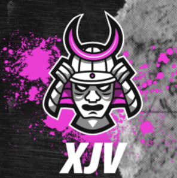

# Valentine Companion

**Torchlight: Infinite farming companion · by xJv**

Cube tracking, farm value and in-game price checks in one Windows desktop app.

## Windows preview

[Download Valentine Companion 0.6.0](https://github.com/JeffValentine/valentine-companion/releases/download/v0.6.0/Valentine-Companion-0.6.0-windows-x64.zip)

Extract the entire ZIP, then open **Valentine Companion.exe**. Python and English OCR are included. Keep `_internal` and `Valentine Update.exe` beside the main app. Windows publisher code signing is not yet available for this preview.

1. Enable logging in Torchlight: Infinite and log in to your character.
2. Open Valentine Companion. It searches common Steam and launcher locations for the game log. Use **Settings → Game capture settings → Browse** if necessary.
3. Keep the tracker running before entering a Cube screen. Use windowed or borderless mode and keep the game visible for screenshots.
4. Use the game's **Price Check**. Returned listings populate your seasonal price book automatically.

## Included

- **Cube:** opening/claim captures, rolls, carryover, Desire Crystals, Divinity Stones, cards, compasses, pets, Void Chart evidence and comparisons.
- **Farm tracker:** classified pickups, consumed entry items, price coverage, map results, strategy tags and weighted FE/hour.
- **Price check:** observed FE listing samples, freshness, ranges and personal overrides. The market is global; seasons keep separate price books. Filtered equipment checks are excluded from generic farming prices.
- **Updates:** automatic checks and verified downloads using a pinned publisher key, with installation on restart.
- **Community:** sharing and service protocols are implemented. **Public community hosting is not connected yet**, so shared prices and global strategy rankings are unavailable in this preview.

## Data and estimates

History is stored locally in `%LOCALAPPDATA%\ValentineCompanion\data`, outside the app folder. Automatic update checks contact this repository. Community sharing is off by default; the sharing protocol excludes game UIDs, raw logs, local paths and screenshots.

Farm values are estimates for known priced items. Unknown prices and missing map budgets remain unknown. Inventory transfers and trades are separated from pickups; unsold loot value is not realised profit. Map residence includes idle time. Exact Void Chart node allocations and incomplete setup evidence may require review.

This repository distributes Windows builds and signed update metadata. It does not publish the development workspace or personal farming history. Game artwork and names belong to their respective owners; reference names and images use Torchlight Infinite Database sources.

Please include the app version and a description of the problem when reporting an issue. Do not post raw game logs containing account information.
